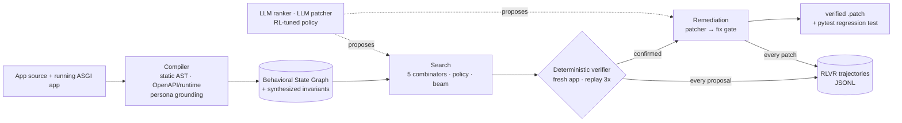

# QbQ ("Cubic")

**An agentic QA & security testing engine that never trusts a model to judge a finding.**

Cubic compiles a web application into a typed **Behavioral State Graph**, searches that
graph for multi-persona test sequences that could break business, security or functional
invariants, and confirms every claim by replaying it **3 out of 3 times** on a freshly
seeded app. Confirmed findings go through a closed loop. A patch is synthesized and kept
only if the exploit stops reproducing *and* no functional QA flow regresses. Every
finding also becomes a standalone pytest regression test. Every proposal and every patch
attempt is recorded as a `(state-graph slice, action, verifiable reward)` trajectory for
RLVR training.

Models (an LLM ranker, an LLM patcher, or an RL-tuned policy) only ever *propose*.
Deterministic assertions on HTTP responses and database state decide.

| | Fintech | B2B SaaS | AI agent / MCP gateway |
| :--- | ---: | ---: | ---: |
| Recall@1 (8 planted (build, bug) pairs each) | 100% | 100% | 100% |
| False-positive rate | 0% (0/112) | 0% (0/172) | 0% (0/184) |
| Findings with a verified patch | 8/8 | 8/8 | 8/8 |

No hand-written probes, and no app-specific rules. Full tables, ablations and
reproduction commands are in [`benchmarks/SUMMARY.md`](benchmarks/SUMMARY.md).

## Quickstart

Requires Python ≥ 3.11 and [uv](https://docs.astral.sh/uv/).

```bash
uv sync
uv run pytest                                  # full test suite

# 1. compile an app (source AST + live OpenAPI/runtime + persona grounding) into a State Graph
uv run cubic compile --app cubic.gym.saas.app:create_app --out graph.json

# 2. search the graph for a prioritized, multi-persona test plan
uv run cubic search --env saas-compiled

# 3. score the autonomous plan on every build of a Bug Gym app (CI gate)
uv run cubic eval --env saas-autonomous --min-recall 1.0 --max-fpr 0.0

# 4. closed loop: verify findings -> synthesize + gate patches -> export regression tests
uv run cubic remediate --env saas --out-dir regression_tests --patch-dir patches --require-verified

# 5. export verifiable-reward trajectories for GRPO / RLVR (train: fintech, eval: saas + agent_gateway)
uv run cubic export-rlvr --out datasets/cubic_rlvr.jsonl --stats rlvr_stats.json
```

### Your own FastAPI app

```bash
uv run cubic compile --app myservice.main:create_app --personas personas.json --out graph.json
uv run cubic remediate --app myservice.main:create_app --personas personas.json \
    [--snapshot myservice.main:db_snapshot] --out-dir regression_tests
```

- `--app` must name a **factory** that returns a fresh app with freshly seeded state on
  every call, because each replay gets its own instance.
- `personas.json` lists `ActorPersona` objects: the seeded test credentials and the
  resources each persona owns. A compiled `StateGraph` JSON works too.
- The optional snapshot hook returns a `DbSnapshot` and enables ledger and state-guard
  invariants. Without it, Cubic checks HTTP-level invariants only.

Only run Cubic against applications you own or are authorized to test.

## How it works



| Layer | Package | What it does |
| :--- | :--- | :--- |
| Schema | `cubic.graph` | `StateNode`, `TransitionEdge`, `ActorPersona`, `InvariantAssertion`, `StateGraph`. Typed, validated, byte-deterministic JSON. |
| Compiler | `cubic.compiler` | Static AST pass (routes, auth, role/ownership/lifecycle guards, ledger writes, locks), dynamic pass (OpenAPI, live route binding, unauthenticated probes), persona grounding, and rule-based invariant synthesis with OWASP API 2023 / OWASP LLM 2025 / CWE tags. |
| Search | `cubic.search` | Five typed combinators: cross-persona replay, parallel contention, lifecycle skip, boundary perturbation, cross-tenant reference. Guard- and state-aware `HeuristicGraphPolicy`, pluggable `LLMGuidedPolicy`, best-first beam search with coverage reasons. |
| Verifier | `cubic.verifier` | Barrier-synchronized replay over in-process ASGI, DB snapshots and row diffs, deterministic checks, 3-of-3 gating, `curl` reproductions. |
| Remediation | `cubic.remediate` | AST rule patcher plus `LLMPatcher`. The fix gate requires 0/3 exploit runs and no functional regression. Also a standalone pytest exporter and the `cubic remediate` pipeline. |
| RLVR | `cubic.rlvr` | Trajectory recorder, programmatic rewards (+1 / 0 / −1), TRL-compatible `VerifierReward`, leakage-checked JSONL export. |
| Bug Gym | `cubic.gym` | Three in-process FastAPI testbeds with togglable defects: `fintech`, `saas`, `agent_gateway`. |
| Eval | `cubic.eval` | Recall@1 / FPR over every build, autonomous environments. |

The design, invariant rules, combinators, reward definitions and their limits are covered
in [`docs/ARCHITECTURE.md`](docs/ARCHITECTURE.md). The product roadmap is in
[`global_agentic_qa_security_engine_build_plan.md`](global_agentic_qa_security_engine_build_plan.md).

## Bug Gym

| Environment | App | Planted defects |
| :--- | :--- | :--- |
| `fintech-*` | Wallets, transfers, loans | IDOR wallet read · withdraw TOCTOU double-spend · loan disbursal skips approval · negative-transfer regression |
| `saas-*` | Workspaces, seat ledger, API keys, subscriptions | cross-tenant workspace read · seat-limit invite race · trial upgraded without activation · negative seat-purchase regression |
| `agent-gateway-*` | Tenants, token credits, agents, MCP-style tool calls, approval-gated actions | cross-tenant conversation read · cross-tenant tool invocation · unbounded `max_tokens` · action executed without human approval |

`*-compiled` environments use the auto-compiled graph. `*-autonomous` environments add the
search-generated plan as the probe set. `fintech` alone also ships a hand-written reference
graph and probes (`--env fintech`), used to measure compiler fidelity.

The testbeds are intentionally vulnerable. They run only in-process.

## CLI reference

| Command | Purpose |
| :--- | :--- |
| `cubic compile` | App → State Graph JSON (`--app`, `--personas`, `--report`, `--no-ground`, `--no-probe`, `--no-invariants`) |
| `cubic search` | Prioritized test plan and per-invariant coverage (`--env` or `--graph`, `--per-invariant`, `--max-tests`) |
| `cubic eval` | Recall@1 / FPR across all builds, with CI gates (`--min-recall`, `--max-fpr`) |
| `cubic remediate` | Verify → patch → gate → export (`--env` or `--app`, `--variant`, `--patch-dir`, `--require-verified`) |
| `cubic export-rlvr` | Trajectory JSONL + stats (`--train`, `--eval`, `--sample-out`, `--stats`) |
| `cubic graph` / `cubic schema` | Dump an environment's graph / the State Graph JSON Schema |

## Repository layout

```
src/cubic/        graph · compiler · search · verifier · remediate · rlvr · gym · eval · cli
tests/            pytest suite (unit, end-to-end, CLI, snapshot consistency)
benchmarks/       benchmark scripts, results/*.json snapshots, SUMMARY.md (generated)
datasets/         cubic_rlvr_sample.jsonl (stratified sample; full export is gitignored)
docs/             ARCHITECTURE.md
```

## Contributing, security, license

See [`CONTRIBUTING.md`](CONTRIBUTING.md) and [`SECURITY.md`](SECURITY.md).

Licensed under either of [Apache License 2.0](LICENSE-APACHE) or [MIT](LICENSE-MIT), at your
option. Unless you explicitly state otherwise, any contribution you intentionally submit
for inclusion is dual-licensed as above, without additional terms or conditions.
